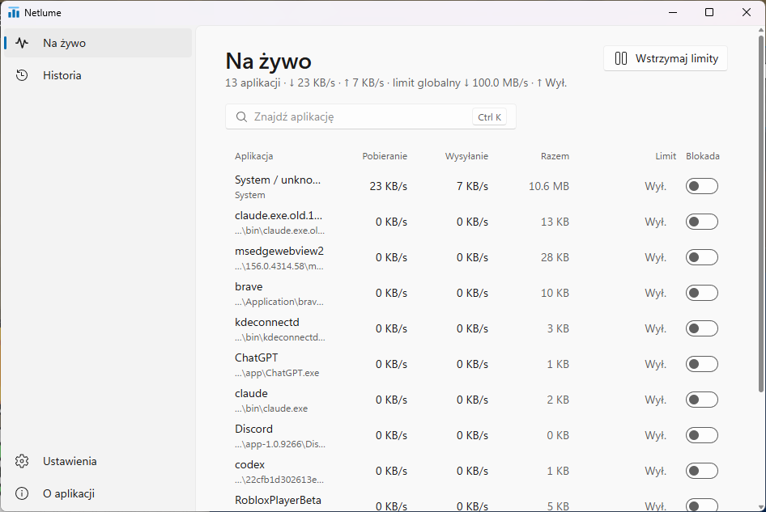
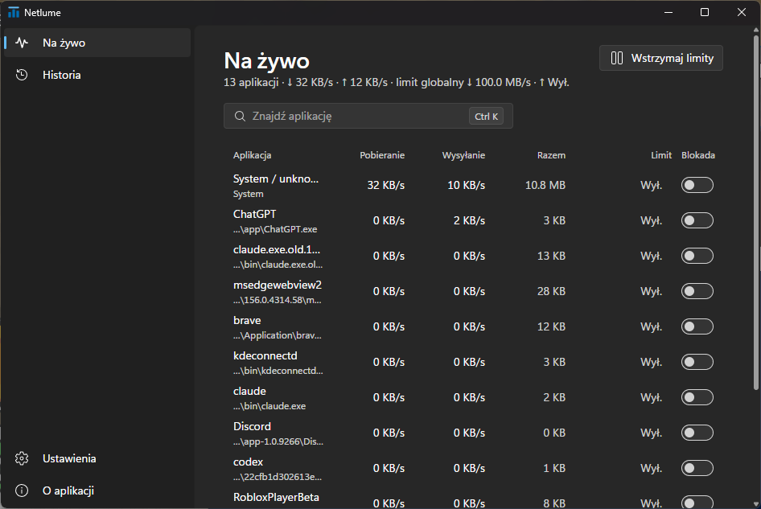

# Netlume

Open-source per-application network monitor and bandwidth limiter for Windows 10 and 11.





## Install

Download `Netlume_0.2.1_x64-setup.exe` from the [releases](https://github.com/prejas3/Netlume/releases) and run it. Netlume needs administrator rights (it filters network traffic through the [WinDivert](https://github.com/basil00/WinDivert) driver), so the installer and the app ask for elevation.

Microsoft Defender may flag WinDivert as unwanted software (a known false positive shared by other WinDivert tools). If it quarantines `WinDivert.dll` or `WinDivert64.sys`, restore them and allow them in Windows Security.

Uninstall from Settings → Apps; this also removes the autostart task.

## Use

- **Live**: every application with network traffic, its download/upload rate and session total.
- **Limit**: set a download and/or upload limit per application, or a global limit for the whole PC.
- **Block**: cut an application off the network.
- **Pause limits**: lift every limit and block at once (Live page, Settings or tray); it resets on restart.
- **History**: daily download/upload totals per application.
- **Settings**: *Start with Windows* (a logon task with highest privileges, so no UAC prompt), language (Polski/English), theme (system/light/dark), global limit, data folder.
- **Tray**: open, pause all limits, *Start with Windows*, quit; in the app's language. Closing the window keeps Netlume running in the tray.

Rules and history live in `%APPDATA%\Netlume` (`rules.json`, `history\YYYY-MM-DD.json`).

## Changelog

- **0.2.1**: tray menu in Polish and English (follows the app language), new app icon.
- **0.2.0**: new interface on SJ Utility UI (Windows 11 look: Mica, side navigation, settings cards, light/dark theme, Polish and English), Settings and About pages.
- **0.1.0**: first release.

## Build

Prerequisites: Node.js, Rust, the Tauri 2 Windows prerequisites, and WebView2.

```powershell
npm install
src-tauri/windivert.ps1      # fetch signed WinDivert 2.2.2 x64 into src-tauri/windivert (not in git)
npm run tauri:dev            # UI dev; unelevated, the engine stays off
npx tauri build              # NSIS installer in src-tauri/target/release/bundle/nsis
```

Release builds request elevation. To run the engine from a dev build, use an elevated terminal with `src-tauri/windivert` on `PATH`.

## Licence

MIT (see `LICENSE`). Third-party components and their licences: `THIRD_PARTY.md`. WinDivert is used under LGPL-3.0, unmodified and loaded dynamically.
